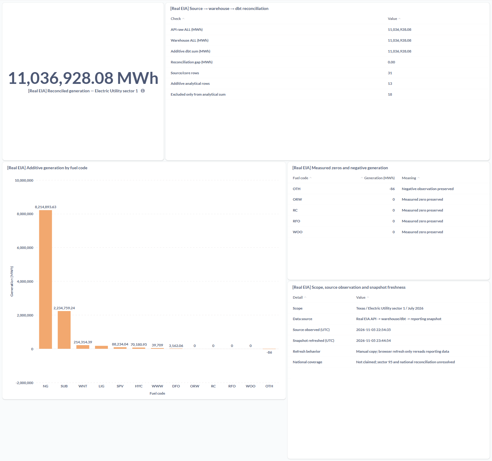
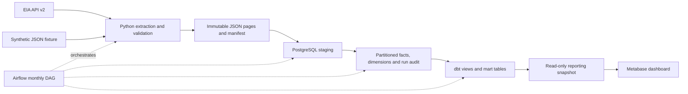

# Energy ETL Warehouse

A monthly electricity-generation pipeline from the public EIA API to Metabase
reporting. It preserves immutable raw data, loads a revision-safe PostgreSQL
warehouse and builds analytical marts with dbt, orchestrated by Airflow.

**Stack:** Python · PostgreSQL · dbt · Apache Airflow · Docker · Metabase.

## Verified real-data pilot

**Texas · July 2026 · Electric Utility sector 1**, across all returned fuel categories.

| Source/core records | Additive analytical rows | Generation (MWh) | Reconciliation difference (MWh) |
|---:|---:|---:|---:|
| 31 | 13 | 11,036,928.08 | 0.00 |



*Actual Metabase dashboard from the verified release capture. Navigation and
margins are cropped; the local ingestion-run identifier is omitted. Data values
and chart content are unchanged. This is a manually refreshed reporting snapshot,
not a live warehouse connection.*

This is one sector in one state/month, not total Texas or national generation.
Nationwide publication remains blocked; reporting refresh is manual and
production scheduler execution has not been verified.

[Architecture](#architecture) · [Setup and execution](docs/demo.md) ·
[Reporting setup](docs/reporting.md) · [Tests and verification](docs/verification.md) ·
[Portfolio summary](docs/portfolio.md)

Source: [EIA API v2 Electric Power Operational Data](https://www.eia.gov/opendata/browser/electricity/electric-power-operational-data).
Source values use thousand megawatthours; warehouse values convert to MWh.
Live extraction requires your own registered API key; fixture verification runs offline.

## Architecture



The DAG executes four tasks:
`extract → load_staging → merge_to_core → run_dbt`.
Its extraction task also persists raw objects. dbt tests and Metabase dashboard
setup are separate steps; Airflow does not manage the reporting snapshot.

A separate synthetic-fixture dashboard contains six verified SQL questions.
Its incomplete reconciliation and undefined latest-month fuel share are documented
in the [reporting guide](docs/reporting.md#reporting-data-boundary).

## Engineering decisions

- **Explicit grain:** one month × geography × sector × fuel type. The business
  key is `(period, location, sectorid, fueltypeid)`.
- **Immutable evidence:** create-only raw writes, separate run and SHA-256
  content identities, and pages written before the completion manifest.
- **Publication safety:** dimensions are classified as leaf, rollup or UNKNOWN.
  Unknown codes remain visible in diagnostics and block core publication through
  `aggregate_publish_gate()`; they never default to leaves.
- **Source semantics:** null differs from zero, finite negative generation is
  valid, and sparse combinations are preserved. Parsing and staging reject
  nonfinite numbers and unsupported units. Canonical source values use
  `thousand megawatthours`; warehouse MWh values multiply these by 1,000.
- **Revision protection:** incremental core publication with immutable run identity
  and transactional PostgreSQL `INSERT ... ON CONFLICT ... DO UPDATE`. A transaction-scoped advisory lock
  serializes cooperating publishers; stale and ambiguous replacements fail
  atomically. Newer identical observations advance provenance.
- **Honest provenance:** fixture and live origins are distinct. `extracted_at`
  orders local observations; it is not an authoritative EIA revision timestamp.
- **Analytical separation:** dbt builds a leaf-only generation mart and a separate
  reconciliation mart. Metabase queries a SELECT-only snapshot, separate from the source warehouse.

## Verified scope and evidence

The final offline audit on **7 November 2026** passed **779 tests**, with
**41 PostgreSQL cases deliberately skipped**. Database verification is a separate
gate; an offline skip is never counted as a database pass.

| Area | Evidence | Boundary |
|---|---|---|
| Offline Python | 779 passed; 41 database cases skipped | Unit, filesystem raw storage, mocked DAG and reporting tests |
| PostgreSQL integration | 41 passed in a fresh isolated PostgreSQL 18.6 target | Real commit/rollback, immutable identity, revisions, stale replay and concurrency |
| Airflow | Two successful four-task local real-data DAG runs | dag.test(use_executor=False); no scheduled execution claimed |
| dbt | Four models built; 12 applicable tests passed | National reconciliation test explicitly excluded for the pilot |
| Real Metabase dashboard | Five questions rendered and matched independent SQL | Separate, manually refreshed reporting snapshot |
| Fixture reporting | Six saved questions remain verified | Static synthetic sample, separate from the real-data dashboard |
| Static checks | Ruff lint/format passed for 43 Python files; shell and Compose checks passed | Configuration validation does not start services |

Real ingestion and the two Airflow runs were executed during the bounded pilot.
The final audit reran offline tests and read-only dbt/reporting checks, and
confirmed the warehouse and immutable raw hashes remain unchanged. It did not
rerun upstream ingestion or a scheduler. See the [verification record](docs/verification.md)
for dated execution boundaries and the final database-test status.

The pilot retains eight measured zero core observations and one negative:
`OTH = -86 MWh`. Its analytical mart includes four measured zeros and the negative.
There are no nulls in this real slice; null preservation is covered separately
by fixture, unit and PostgreSQL tests.

The full July API diagnostic retrieved 17,423 records. Its 122 sector-95
observations remain UNKNOWN, and national reconciliation remains unresolved.
That full batch was **not published**. A successful bounded pilot does not prove
complete Texas or nationwide generation.

The existing fixture dashboard and the new real-data dashboard use the same
loopback-only Metabase installation, separate reporting databases and SELECT-only
reporting access. Original captures, operational credentials and private verification
receipts remain outside the repository.
See the [reporting guide](docs/reporting.md#real-eia-reporting-snapshot) for
refresh commands and the [portfolio summary](docs/portfolio.md) for interview wording.

## Start offline

Use Linux or WSL Ubuntu and Python 3.11+. Airflow requires a supported Python
version; the dependency ranges in `pyproject.toml` are not locked.

```bash
python3 -m venv .venv
.venv/bin/python -m pip install -e ".[dev]"

ENERGY_TEST_PG=0 .venv/bin/python -m pytest tests/ dags/tests/ metabase/tests/ -ra

git ls-files -z -- '*.py' | xargs -0 .venv/bin/ruff check --no-cache
git ls-files -z -- '*.py' | xargs -0 .venv/bin/ruff format --check --no-cache
```

The offline collection includes unit tests, filesystem raw-storage integration,
mocked DAG tests and static Metabase asset tests. No API key or running database,
Airflow scheduler or Metabase service is required. The Airflow package must be
installed for DAG tests. Keep the filesystem integration tests in the offline gate.

For an extraction/validation/raw-sink walkthrough that needs no database, follow
the [demo guide](docs/demo.md#offline-fixture-walkthrough).

## Database and full-demo setup

PostgreSQL 18, dbt Core with the PostgreSQL adapter, Airflow 3 and Docker/Metabase
were used for the verified demonstration. Docker supplied isolated reporting
PostgreSQL, Metabase and a loopback-only reverse proxy; it is not required for
the Python-only walkthrough.

Use a newly provisioned disposable database, a restricted role, a new raw
namespace and an isolated Airflow environment. Explicitly configure
`POSTGRES_DSN` and every `DBT_PG_*` connection field. Missing warehouse connection
settings fail closed; no production connection defaults are supplied. API credentials are needed only for live
extraction and must remain outside Git.

**The full ETL deployment is not yet a one-command fresh-clone setup.**
The [canonical reporting setup](docs/reporting.md) now defines a separate
PostgreSQL/Metabase/nginx project on loopback port 3002 with a static synthetic
reporting sample. It does not adopt the existing dashboard on port 3001, run
ETL/dbt/Airflow, or automatically create saved questions. A fresh isolated
reporting installation passed on 5 November 2026: database initialization, private
tmpfs secrets, reader permissions and six questions rendered as four charts and
two tables in Chrome. Metabase setup was an explicit API step; the guide provides
a manual UI workflow. This is reporting-only verification, not full-project
fresh-install reproducibility.
`scripts/init_pipeline.py` also runs the full dbt test suite, including
reconciliation that the fixture cannot pass. The
[demo guide](docs/demo.md#isolated-warehouse-demonstration) documents the
prerequisites and current reproduction gaps.

The real PostgreSQL harness is opt-in, requires an empty pre-provisioned schema,
and checks explicit connection identity before writes. It requires an approved
disposable environment with explicit cluster identity and a canonical Unix-socket
DSN. Read the
[PostgreSQL testing instructions](docs/demo.md#real-postgresql-integration-tests)
before enabling it; never point it at an existing warehouse.

## Repository layout

```text
src/energy_pipeline/     API client, pagination, records, raw storage, validation and loaders
sql/001_schema.sql      PostgreSQL staging, dimensions, partitioned facts and audit schema
dags/                   Monthly four-task DAG and mocked orchestration tests
dbt/                    Sources, four models, schema tests and reconciliation test
metabase/cards/         Six synthetic-fixture SQL questions
metabase/real_data/     Real-pilot snapshot schema and five SQL questions
metabase/dashboards/    Fixture and real-data dashboard blueprints, not API exports
docker/                 Reporting proxy and new-volume fixture initialization
docs/reporting.md       Canonical reporting setup and manual dashboard recreation
tests/                  Unit, filesystem and opt-in PostgreSQL integration tests
data/fixtures/eia/      Synthetic and captured-response fixtures
docs/demo.md            Safe setup, fixture walkthrough and reproduction gaps
docs/portfolio.md       Recorded evidence, resume bullets and interview explanation
docs/verification.md    Final verification scope, release gates and limitations
```

## Limitations and next improvements

- Full national publication remains blocked: sector `95` is UNKNOWN, and
  national generation reconciliation is unresolved. The bounded Texas sector-1
  pilot does not resolve these wider coverage questions; see the current evidence
  in [source research](docs/source-data.md).
- The incomplete fixture cannot establish national reconciliation. Its fixture
  dashboard comparison uses an INNER JOIN, so missing June/August source totals
  are omitted. The real pilot uses a separate scoped reconciliation; the national
  dbt test remains intact and excluded for both incomplete demonstrations.
- Latest-month fixture generation is zero, making fuel shares undefined/NULL;
  the demonstration uses a table rather than a pie chart.
- Dimension names may be missing; charts use codes. Dashboard filters are not
  implemented, and snapshot refresh is manual.
- Local `dag.test()` success does not establish scheduler reliability.
- Fact-to-dimension/audit relationships are checked logically; physical foreign
  keys are absent. Direct SQL writers can bypass application safeguards.
- Portable isolated provisioning, dependency locking and automated CI are follow-up work.
- Full source coverage, revision horizon and source-withdrawal handling need
  further evidence or explicit policy.

[Source research](docs/source-data.md) and [model notes](docs/data-model.md)
contain detailed contracts and historical milestones. Their old phase/status
statements are not current execution evidence.

## License and data attribution

Original project code and documentation are licensed under [MIT](LICENSE).
EIA-derived data and third-party software retain separate terms; see
[third-party notices](THIRD_PARTY_NOTICES.md). The constructed
test fixture contains some EIA-derived sample values, not a complete national dataset.
