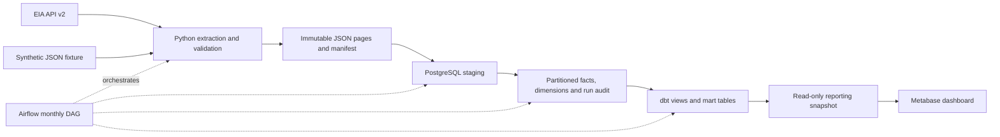

# Energy ETL Warehouse

A local-first data engineering project for monthly U.S. electricity generation.
It combines Python ingestion, immutable raw storage, a PostgreSQL dimensional
warehouse, dbt models, Apache Airflow orchestration and Metabase reporting.

**A synthetic-fixture demonstration has been verified end to end.** A separate
live EIA extraction succeeded, but publication of that full month remains
blocked by unclassified dimension codes. Production reconciliation and
scheduler-driven operation are not claimed.

## Architecture



The DAG executes four tasks:
`extract → load_staging → merge_to_core → run_dbt`.
Its extraction task also persists raw objects. dbt tests and Metabase dashboard
setup are separate steps; Airflow does not manage the reporting snapshot.

Six saved SQL questions executed and rendered against the synthetic fixture
snapshot. The genuine Metabase interface screenshot is retained privately and
omitted from this public snapshot. Zero and negative observations are intentional;
reconciliation coverage is incomplete, so this is not a national generation report.

## Engineering decisions

- **Explicit grain:** one month × geography × sector × fuel type. The business
  key is `(period, location, sectorid, fueltypeid)`.
- **Immutable evidence:** create-only raw writes, separate run and SHA-256
  content identities, and pages written before the completion manifest.
- **Publication safety:** dimensions are classified as leaf, rollup or UNKNOWN.
  Unknown codes remain visible in diagnostics and block core publication through
  `aggregate_publish_gate()`; they never default to leaves.
- **Source semantics:** null differs from zero, finite negative generation is
  valid, and sparse combinations are preserved. Parsing and staging reject
  nonfinite numbers and unsupported units. Canonical source values use
  `thousand megawatthours`; warehouse MWh values multiply these by 1,000.
- **Revision protection:** incremental core publication with immutable run identity
  and transactional PostgreSQL `INSERT ... ON CONFLICT ... DO UPDATE`. A transaction-scoped advisory lock
  serializes cooperating publishers; stale and ambiguous replacements fail
  atomically. Newer identical observations advance provenance.
- **Honest provenance:** fixture and live origins are distinct. `extracted_at`
  orders local observations; it is not an authoritative EIA revision timestamp.
- **Analytical separation:** dbt builds a leaf-only generation mart and a separate
  reconciliation mart. Metabase queries a SELECT-only snapshot, separate from the source warehouse.

## Recorded verification

The fixture/API/database results below are recorded October 2026 verification.
The public-snapshot safety gate was rerun offline on 28 October 2026: 549 passed,
41 database cases deliberately skipped, and Ruff lint/format checks passed on all
the Python files checked. The real PostgreSQL suite was not rerun.

| Area | Result | Boundary |
|---|---|---|
| Offline Python suite | 549 passed; 41 PostgreSQL cases deliberately skipped | No live services; skipped cases are not database verification |
| Real PostgreSQL integration | 41 passed on isolated PostgreSQL 18.6 | Separate disposable database; revisions, rollback and concurrent publication exercised |
| Live extraction | 17,423 records retrieved for July 2026 | Extraction only; full-month publication blocked by UNKNOWN codes |
| Airflow | Four local `dag.test()` tasks succeeded in 56.6 seconds | No scheduler-driven execution verified |
| Warehouse | 10 synthetic fixture facts published | Provenance and business-key uniqueness checked |
| dbt | Four models and 12 applicable tests passed | National reconciliation test excluded for the incomplete fixture |
| Metabase | Six saved SQL questions executed and rendered | Browser results matched independent reporting SQL |
| Reporting snapshot | Monthly mart: six rows; reconciliation mart: one row | Verified static snapshot, not continuous synchronization |

A separate fresh reporting installation was verified on 5 November 2026 using
the repository Compose setup, a static six-row/one-row analytical sample and
explicit Metabase provisioning. PostgreSQL 18.6, Metabase v0.50.27 and nginx 1.30.6
were used; all six browser responses matched SQL. This did not rerun ETL/dbt/Airflow
or the full Python/PostgreSQL test suites. See the [reporting guide](docs/reporting.md)
for its verification boundary and setup steps.

See [portfolio evidence and interview summary](docs/portfolio.md) for the scope
of these results.

## Start offline

Use Linux or WSL Ubuntu and Python 3.11+. Airflow requires a supported Python
version; the dependency ranges in `pyproject.toml` are not locked.

```bash
python3 -m venv .venv
.venv/bin/python -m pip install -e ".[dev]"

ENERGY_TEST_PG=0 .venv/bin/python -m pytest tests/ dags/tests/ metabase/tests/ -ra

git ls-files -z -- '*.py' | xargs -0 .venv/bin/ruff check --no-cache
git ls-files -z -- '*.py' | xargs -0 .venv/bin/ruff format --check --no-cache
```

The offline collection includes unit tests, filesystem raw-storage integration,
mocked DAG tests and static Metabase asset tests. No API key or running database,
Airflow scheduler or Metabase service is required. The Airflow package must be
installed for DAG tests. Keep the filesystem integration tests in the offline gate.

For an extraction/validation/raw-sink walkthrough that needs no database, follow
the [demo guide](docs/demo.md#offline-fixture-walkthrough).

## Database and full-demo setup

PostgreSQL 18, dbt Core with the PostgreSQL adapter, Airflow 3 and Docker/Metabase
were used for the verified demonstration. Docker supplied isolated reporting
PostgreSQL, Metabase and a loopback-only reverse proxy; it is not required for
the Python-only walkthrough.

Use a newly provisioned disposable database, a restricted role, a new raw
namespace and an isolated Airflow environment. Explicitly configure
`POSTGRES_DSN` and every `DBT_PG_*` connection field. Missing warehouse connection
settings fail closed; no production connection defaults are supplied. API credentials are needed only for live
extraction and must remain outside Git.

**The full ETL deployment is not yet a one-command fresh-clone setup.**
The [canonical reporting setup](docs/reporting.md) now defines a separate
PostgreSQL/Metabase/nginx project on loopback port 3002 with a static synthetic
reporting sample. It does not adopt the existing dashboard on port 3001, run
ETL/dbt/Airflow, or automatically create saved questions. A fresh isolated
reporting installation passed on 5 November 2026: database initialization, private
tmpfs secrets, reader permissions and six questions rendered as four charts and
two tables in Chrome. Metabase setup was an explicit API step; the guide provides
a manual UI workflow. This is reporting-only verification, not full-project
fresh-install reproducibility.
`scripts/init_pipeline.py` also runs the full dbt test suite, including
reconciliation that the fixture cannot pass. The
[demo guide](docs/demo.md#isolated-warehouse-demonstration) documents the
prerequisites and current reproduction gaps.

The real PostgreSQL harness is opt-in, requires an empty pre-provisioned schema,
and checks explicit connection identity before writes. It requires an approved
disposable environment with explicit cluster identity and a canonical Unix-socket
DSN. Read the
[PostgreSQL testing instructions](docs/demo.md#real-postgresql-integration-tests)
before enabling it; never point it at an existing warehouse.

## Repository layout

```text
src/energy_pipeline/     API client, pagination, records, raw storage, validation and loaders
sql/001_schema.sql      PostgreSQL staging, dimensions, partitioned facts and audit schema
dags/                   Monthly four-task DAG and mocked orchestration tests
dbt/                    Sources, four models, schema tests and reconciliation test
metabase/cards/         Six analytical SQL queries
metabase/dashboards/    Descriptive dashboard blueprint, not a Metabase export
docker/                 Reporting proxy and new-volume fixture initialization
docs/reporting.md       Canonical reporting setup and manual dashboard recreation
tests/                  Unit, filesystem and opt-in PostgreSQL integration tests
data/fixtures/eia/      Synthetic and captured-response fixtures
docs/demo.md            Safe setup, fixture walkthrough and reproduction gaps
docs/portfolio.md       Recorded evidence, resume bullets and interview explanation
```

## Limitations and next improvements

- Complete fuel/sector classification still requires source evidence. Sectors
  `8`, `90` and `94`–`99` remain UNKNOWN; their previously reported labels
  are not independently verified by a saved facet response.
- The incomplete fixture cannot establish national reconciliation. The dbt
  production reconciliation test remains intact. The dashboard comparison uses
  an INNER JOIN, so missing June/August source totals are omitted.
- Latest-month fixture generation is zero, making fuel shares undefined/NULL;
  the demonstration uses a table rather than a pie chart.
- Dimension names may be missing; charts use codes. Dashboard filters are not
  implemented, and snapshot refresh is manual.
- Local `dag.test()` success does not establish scheduler reliability.
- Portable isolated provisioning, dependency locking and automated CI are follow-up work.
- Full source coverage, revision horizon and source-withdrawal handling need
  further evidence or explicit policy.

[Source research](docs/source-data.md) and [model notes](docs/data-model.md)
contain detailed contracts and historical milestones. Their old phase/status
statements are not current execution evidence.

## License and data attribution

Original project code and documentation are licensed under [MIT](LICENSE).
EIA-derived data and third-party software retain separate terms; see
[third-party notices](THIRD_PARTY_NOTICES.md). The constructed
test fixture contains some EIA-derived sample values, not a complete national dataset.
